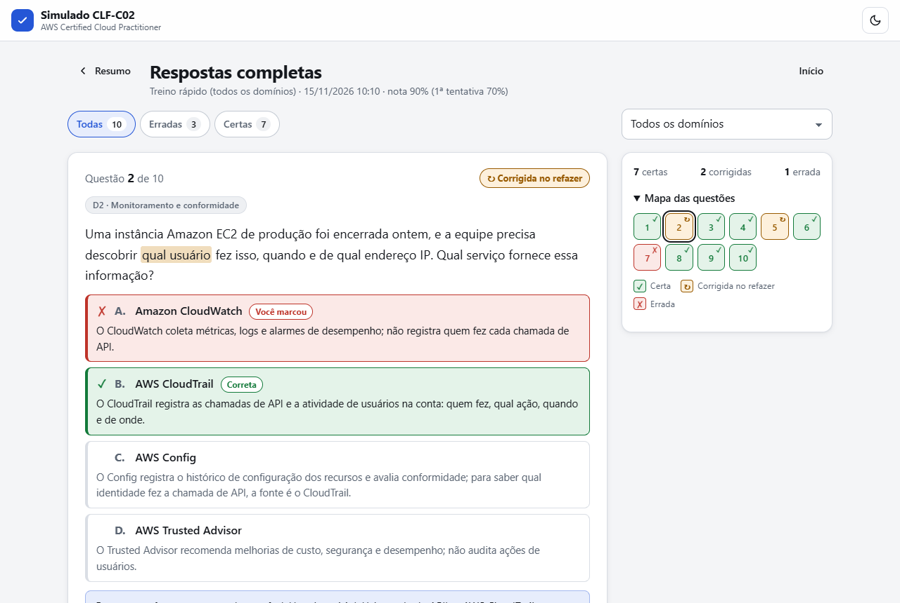

# CLF-C02 practice exam in Brazilian Portuguese

A free practice exam for the **AWS Certified Cloud Practitioner (CLF-C02)**: 235 original questions in Brazilian Portuguese, with AWS service names kept in English, as in the real exam.

> Independent project, not affiliated with or endorsed by AWS. All questions are original.

**Live site:** https://leonardo062908.github.io/simulado_aws_practitioner/



## What it does

- **Full exam:** 65 questions in 90 minutes, split by the official domain weights (D1 16 · D2 20 · D3 22 · D4 7). Timer, flag for review, and no answers shown while you take it.
- **Quick practice:** pick a domain and/or topic and 10, 20 or 30 questions.
- **Retry the ones you missed:** after each attempt, retry only the wrong questions, as many rounds as you need. Your first-attempt score is kept.
- **Full answers:** every question with the correct option highlighted and the reason, why each wrong option is wrong, what you marked, and the keyword in the question that leads to the answer. Filter by wrong, right or domain. Works on phones.

Your progress stays in your browser (`localStorage`). No account, no backend, no tracking.

## Stack

Plain HTML, CSS and JavaScript: no framework, no build step and no runtime dependencies. Node.js is only used for the validation and test scripts. Deployed to GitHub Pages with GitHub Actions.

## Run locally

```bash
git clone https://github.com/Leonardo062908/simulado_aws_practitioner.git
cd simulado_aws_practitioner
npx serve .            # or: python -m http.server 3000
```

Open http://localhost:3000. Opening `index.html` straight from disk does not work: browsers block loading the JSON files over `file://`.

## Question bank

The questions live in `questions/d1-conceitos.json` to `questions/d4-precos.json`. Each option has its own explanation: the correct one says why it answers the question, and each wrong one says what that service actually does and why it doesn't fit. The `trigger` field holds the keyword that points to the answer. Support plan questions follow the plans listed in the CLF-C02 exam guide (Basic, Developer, Business, Enterprise On-Ramp and Enterprise).

```bash
node validate.js        # checks the bank: unique IDs, option and answer counts, an explanation for every option
node test.js            # unit tests for the exam logic, the validator and broken links
```

## License

[MIT](LICENSE)
